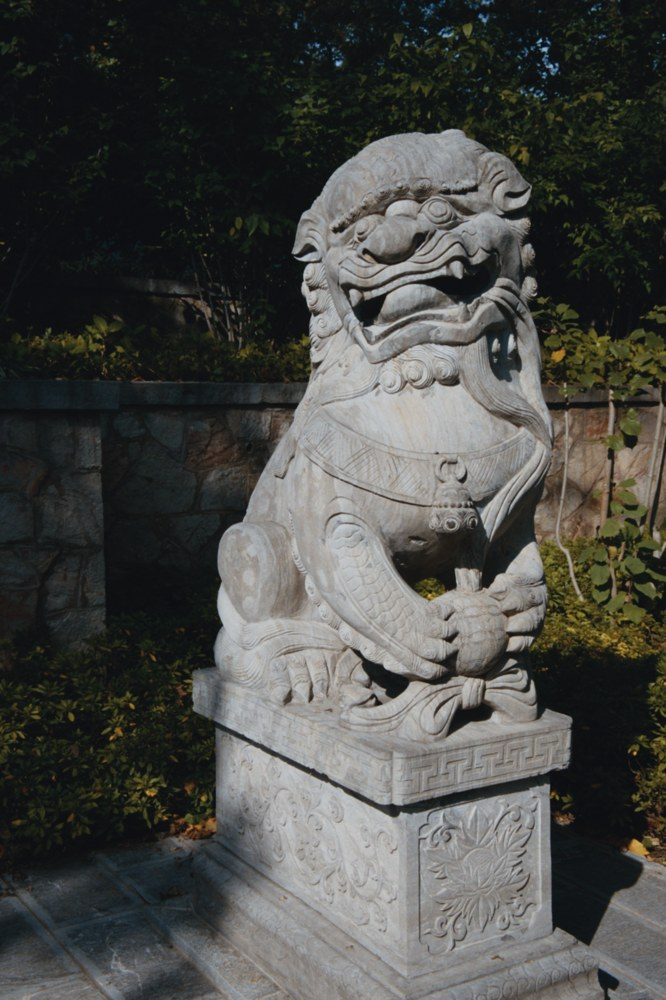

# Nikon Z50II 的 HE / HE\* NEF 支持补丁 — 面向 Film-Simulation / SpektraLab（Windows 版）

> ## ⚠️ 本仓库由 AI 生成，且不会被维护
>
> **AI 声明**：本仓库的补丁、文档、构建脚本与验证记录，全部由 AI 助手（DeepSeek Harness 中的编码 agent）分析、编写并实测完成。人类用户只提供了一台装了该软件的 Windows 机器、一段需求，以及相机拍摄的 RAW 样片。
>
> **不维护声明**：作者**不会**维护本仓库。不会跟进上游更新，不承诺修复新问题，不接受功能请求或 PR，也不保证任何形式的支持。这里的代码是"某一天能跑通"的快照，不是产品。
>
> **无担保**：按 GPL-3.0 第 15、16 条，本仓库不提供任何担保。

---

## 这是什么

一个**补丁集**，不是代码仓库的副本。它让 [trouble123456/Film-Simulation](https://github.com/trouble123456/Film-Simulation)（SpektraLab 的 Windows 转译版，v3.0.0）能够导入 **Nikon Z50II** 拍摄的 **HE / HE\***（"高效"、"高效★"）压缩 NEF。

只改 3 个文件，约 30 行；不逆向任何格式，核心是**把内置的 LibRaw 从 0.22.2 升到 0.23.0（202611 快照）**——那个版本才带上 Nikon HE 解码器和 Z50II 的色彩矩阵。

**本仓库不包含上游源码，也不分发任何编译产物。**

## 问题

Z50II 的 NEF 在软件里导入即失败：

```
open -> decode_failed: "RAW unpack: decoder reported corrupt data"
```

`probe` 和缩略图都正常（缩略图走的是内嵌 JPEG 预览），只有真正的 RAW 解码挂掉，所以现象看起来像"文件坏了"。

## 原因

| 事实 | 依据 |
|---|---|
| 文件是 HE 压缩 | 主图像 `Compression = 34713`，14 bit，数据起始 4 字节为 `FF 10 FF 50`（JPEG XS 的 SOC + CAP） |
| 内置 LibRaw 0.22.2 没有 HE 解码器 | `nikon_he_load_raw()` 只是个会 `throw LIBRAW_EXCEPTION_UNSUPPORTED_FORMAT` 的占位函数 |
| 0.22.2 也没认出这台机器 | HE 识别分支只写了 `NIKON Z 9 / Z 8 / Z f / Z6_3`，`Z50_2` 不匹配，掉进了普通 `nikon_load_raw` |
| 0.22.2 没有 Z50II 的色彩矩阵 | `colordata.cpp` 里只有 `Z 50 / Z 5 / Z 6 …`，没有 `Z50_2` |

于是 JPEG XS 码流被当成 Nikon 无损压缩去解，得到 "corrupt data"。**即使当时拍的是无损压缩 NEF，0.22.2 也因为没有色彩矩阵而颜色错误**——所以这个补丁对无损 NEF 同样是必需的。

完整的排查过程、字节级证据和每一步的复现命令见 [docs/root-cause.md](docs/root-cause.md)。

## 补丁内容

| 文件 | 改动 |
|---|---|
| `engine/cmake/LibRaw.cmake` | 版本校验 0.22.2 → 0.23.0；源码目录默认值改为 `LibRaw-0.23.0` |
| `engine/setup-libraw.ps1` | 下载源改为 202611 快照的固定 commit `a9a14b1`，附 SHA-256，并断言 `LIBRAW_VERSION_TAIL` 确实是 `Snapshot202611` |
| `engine/src/io/raw_decoder.cpp` | 删掉 `supported_compression()` 里"只要解码器叫 `nikon_he_load_raw` 就拒绝"的硬拦截 |

第三处是关键：那段拦截是 0.22.2 时代为了给用户一句人话报错而加的，现在 LibRaw 真能解了，它会**误杀本来能解开**的文件。

LibRaw 0.23.0 侧**不需要任何修改**：它已经识别 `Z50_2 / Z5_2 / ZR` 的 HE 码流并路由到新解码器，也已经内置 `Z50_2` 的矩阵。

## 使用

### 1. 拿到上游源码

```bash
git clone https://github.com/trouble123456/Film-Simulation
cd Film-Simulation
# 主代码在该仓库的 Film-Simulation-src.zip 里，解压到 src/
unzip Film-Simulation-src.zip -d src
```

### 2. 打补丁

```bash
cd src
git apply /path/to/z50ii-he-support.patch
```

（补丁验证过能干净地 `git apply` 到 v3.0.0 的原始源码上。）

### 3. 重新编译 host

只需要重编 `filmlab-host.exe`，不必动 Tauri 外壳——外壳只是通过 IPC 找同目录的这个文件。

```powershell
.\build-host.ps1 -AppDirectory "<解压后的应用目录>"
```

前置条件与完整步骤写在脚本头部：MinGW-w64 gcc ≥ 15、CMake ≥ 3.20、Ninja、`glslangValidator`、Python ≥ 3.12、Meson 1.9.x。首次跑完约 20–30 分钟，大部分时间花在 GLib 和 OpenEXR 上。

### 4. 替换

把编出来的 `filmlab-host.exe` 连同同版本的 `libgcc_s_seh-1.dll`、`libstdc++-6.dll`、`libgomp-1.dll`、`libwinpthread-1.dll` 放到 `胶片模拟 3.0.exe` 旁边即可。

> 应用目录请使用**纯 ASCII 路径**。路径里的非 ASCII 字符或沙箱化的目录（带 Medium 完整性标签的）会让 WebView2 报 `0x80070005 拒绝访问`，窗口起不来。

## 验证

在 RTX 5070 Ti / Windows 上，用 `WRF_0793.NEF`（17,156,096 字节，HE，3728×5600）实测：

| 步骤 | 结果 |
|---|---|
| `probe` | ok，`model Z50_2`，`as_shot {4732 K, tint 16.4}` |
| `open` | ok，decode 354 ms |
| `render` | live 1704×2560，`first_view` 上屏 1.8 s |
| `export` | TIFF16 sRGB 3728×5600，125,263,424 字节 |

图形界面里也跑通了整条链路，程序自身日志：

```
open s1 ...\WRF_0793.NEF 3728x5600 decode 346 ms, open 187 ms
session: open {"call_ms":793.9,"host_decode_ms":346.5,"core":"native-vulkan"}
session: first_view {"event":"committed","total_ms":1811.8,"width":1704,"height":2560}
session: first_view {"event":"draw_submitted","commit_to_draw_ms":13.5}
```



另一张 `WRF_0716.NEF`（5600×3728，无旋转）复核同样成功。

## 已知限制

- **只验证了 Nikon Z50II**。机器上没有其他机型的样片，其他相机能否照常打开没有测过。LibRaw 0.22.2 → 0.23.0 是跨版本升级（ABI 变了，`LibRaw()` 构造函数多了一个 `caller_abi` 参数）；从代码看本项目用到的接口都在，但"没测过"就是没测过。
- **只重建了 host**。`胶片模拟 3.0.exe`（Tauri 外壳）没有改动，也没有重新签名。
- **专利**。HE / HE\* 是 intoPIX 的 TicoRAW，intoPIX 声明了相关专利，LibRaw 的解码器同样未获授权。个人使用影响有限；**再分发请自行评估**。这也是 LibRaw 长期不带该解码器的原因之一。
- **上游文档仍写着"不支持 HE"**。`engine/WINDOWS_NATIVE_RAW.md` 等文件里的说法是旧的，本补丁只改代码，没有改那些说明文字。
- **内存**。LibRaw 的 HE 解码是 3-pass，每像素额外约 8 字节中间缓冲；20 MP 大约多占 160–200 MB，45 MP 会到 400 MB 左右。

## 来源与致谢

这不是从零开始的代码，所有真正的工作都属于上游：

```
andreavolpato/spektrafilm           光谱胶片与相纸模型、28 款实测配置、RA-4 印相与扫描链路
        ↓                            作者 Andrea Volpato（KTH），profiles 为 CC BY-SA 4.0
JamesQiu2005/SpektraLab             原生 C++ / Metal 引擎移植与 macOS 应用，GPL-3.0
        ↓                            作者 Qiu Hanze（@JamesQiu2005）
trouble123456/Film-Simulation       上述项目的 Windows 转译版（C++/Vulkan、LibRaw、Tauri 外壳），GPL-3.0
        ↓
本仓库                               仅一个让 Z50II HE NEF 能导入的补丁
```

另外：

- **LibRaw**（[libraw.org](https://www.libraw.org/)，LGPL-2.1 或 CDDL-1.0 双许可）提供 RAW 解码。本补丁升级到的 202611 快照里的 Nikon HE/HE\* 解码器是 **LibRaw 项目自己的成果**，不是本仓库写的。
- 软件捆绑的胶片/相纸 profiles 是 **Andrea Volpato** 的测量数据，CC BY-SA 4.0。
- 本项目与上述任何项目**均无隶属或背书关系**。

## 许可证

本仓库的补丁修改的是 GPL-3.0-or-later 的代码，因此以 **GPL-3.0-or-later** 分发，见 [LICENSE](LICENSE)。第三方组件的许可见 [THIRD-PARTY.md](THIRD-PARTY.md)。

---

## English summary

A patch set (not a copy of the upstream project) that makes the Windows port of SpektraLab — `trouble123456/Film-Simulation` v3.0.0 — open **Nikon Z50II** `HE` / `HE*` (TicoRAW / JPEG XS) NEF files.

**Root cause:** the bundled LibRaw 0.22.2 has no Nikon HE decoder (`nikon_he_load_raw` is a stub that throws), does not recognise the `Z50_2` model string, and has no `Z50_2` colour matrix — so HE data was handed to the plain Nikon decoder and reported as corrupt.

**Fix:** bump the bundled LibRaw to the 0.23.0 202611 snapshot (which ships the HE decoder, the routing and the `Z50_2` matrix), and drop a now-obsolete guard in `raw_decoder.cpp` that rejected any `nikon_he_load_raw` by name. Three files, about 30 lines. No format was reverse-engineered.

**Generated by AI, and unmaintained.** No support, no updates, no PRs. Provided as-is under GPL-3.0-or-later, with no warranty. Verified on Windows with an RTX 5070 Ti against a real Z50II HE NEF; no other camera body was tested.
